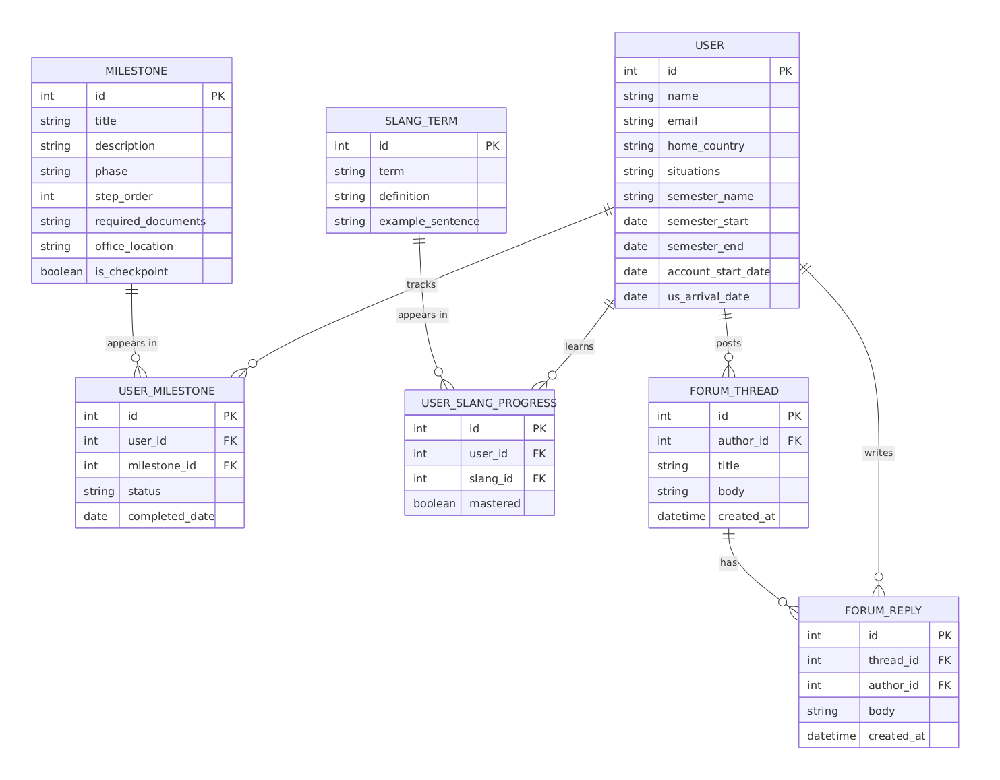

# GlobalCougar | BYU International Student Hub

## App Summary
Moving to BYU as an international student is difficult because paperwork, visa deadlines, and campus resources are spread out everywhere. New F-1 students have to deal with strict immigration rules like submitting their I-94 forms while also figuring out classes and living in Provo. Right now, there is no single dashboard where international students can track their arrival tasks and get familiar with BYU culture at the same time. GlobalCougar solves this problem by giving international students an all-in-one onboarding website to manage their transition. The platform lets students check off their required onboarding milestones, and their progress saves permanently to a live database. It also includes local BYU slang guides and community discussion boards so students can get acclimated socially without feeling overwhelmed.

## ERD
Our data model uses 7 normalized entities to handle student onboarding checklists, campus slang mastery, and community forum discussions.

### Entities and Relationships
- USER to USER_MILESTONE (1 to Many): Connects each student to their assigned onboarding checklist items.
- MILESTONE to USER_MILESTONE (1 to Many): Master list of university requirements like I-94 submission and TB testing linked to student records.
- USER to USER_SLANG_PROGRESS (1 to Many): Tracks which BYU slang terms each student has learned.
- SLANG_TERM to USER_SLANG_PROGRESS (1 to Many): Master list of campus vocabulary and definitions.
- USER to FORUM_THREAD (1 to Many): Links student authors to discussion threads they post.
- FORUM_THREAD to FORUM_REPLY (1 to Many): Connects replies to discussion threads.
- USER to FORUM_REPLY (1 to Many): Tracks which student wrote each reply.

## Tech Stack
- Frontend and UI (Lovable): We used Lovable to build and scaffold the frontend. It generated our React components and styled everything with Tailwind CSS, which let us build the user interface fast without writing custom CSS from scratch.
- Backend and Database (Supabase / PostgreSQL): We used Supabase for our database. It provides a hosted PostgreSQL database with an easy table editor, allowing our frontend to read and write data directly without having to set up and manage a separate backend server.
- Why this fits our team: Using Lovable for the frontend design and Supabase for the database let us set up a working full-stack app quickly so we could focus on getting our data persistence working.

## How to Get It Running

### Prerequisites
- Node.js (v18+)
- npm

### Setup Steps
1. Clone the repository:
git clone https://github.com/jwhas/globalcougar-hub-spark.git
cd globalcougar-hub-spark

2. Install packages:
npm install

3. Set up environment variables:
Create a .env file in the root folder with your Supabase credentials:
VITE_SUPABASE_URL=https://qyekvqxjwecncalfiaef.supabase.co
VITE_SUPABASE_ANON_KEY=your_supabase_anon_key

4. Start the app:
npm run dev

5. Open http://localhost:8080 in your browser.

## Verifying the Vertical Slice
1. Trigger the action: In the Assigned Onboarding Checkpoints section at the top, click Mark Complete on Milestone 2: Complete TB Skin Test.
2. UI update: The button turns green, changes to Completed, and the counter updates from 1 / 2 to 2 / 2.
3. Database write: The app updates the USER_MILESTONE table in Supabase, setting status to completed and saving the completed date.
4. Refresh check: Refresh the page with Cmd + R. The button stays marked as Completed, proving the change is saved in the database across reloads.
